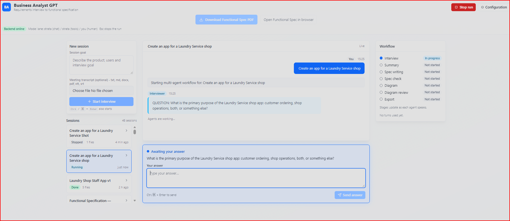
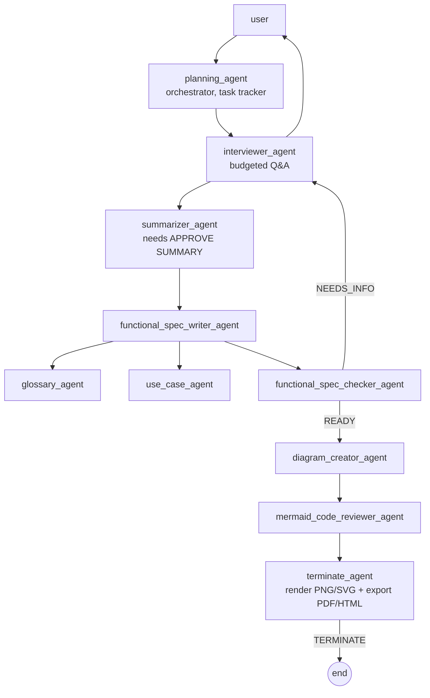

# BA-GPT — Multi-Agent Business Analyst

A local-first AI business analyst that runs a budgeted, deterministic requirements
interview with you and produces a traceable **Functional Specification Document
(FSD)** — PDF, HTML and Markdown — plus Mermaid process diagrams.

"Local-first" means the app, your files, the indexes and the rendering all run on
your machine. If you pick a remote model profile (OpenAI, Azure, Groq, Hugging
Face, GitHub Copilot) the interview content is sent to that provider — the
`ollama`, `lmstudio`, `strata` and `onnx` lanes keep everything on your machine.
Web RAG only fetches the URLs you list in `SITES` (`lib/rag_config.yaml`).

**HTML** is the recommended way to read the spec · **PDF** is for signed or printed
copies · **Markdown** is the best base for AI coding agents.

*Part of a Master's thesis (TFM) in Artificial Intelligence on multi-agent
requirements elicitation. Designed and built by
[Juan Manuel Mirón](https://www.linkedin.com/in/juanmanuelmiron/).*




**See it without installing anything:**
[interactive demo replay](https://portfolio-jun-9193.vercel.app/ba-gpt/demo/)
(a recorded session you can pause, speed up, and read with or without the
internal agent messages) · [sample output](examples/sample_session/)

Built on **AutoGen 0.7.5** (selector group chat), a React/Vite web UI over a
FastAPI adapter (Chainlit remains the operator/debug view), and two stdio **MCP
servers** for diagram rendering and document export.

> **Technical preview (v1.3.0).** The agent team, pipeline and deliverable
> formats are stable enough for evaluation; details may still change. The
> Chainlit view exposes internal pipeline state (agent statuses, raw
> `[ASSIGNMENT]` dispatches, tool traces) — great for auditing the workflow,
> noisy for everyday use; the React UI is the operator-facing front-end.
> Changelog: [releases](https://github.com/junmiron/ba-gpt/releases).

---

## Features

Each feature has a design doc under `docs/features/`.

### Interview and workflow

- **Budgeted, deterministic interview** — the planning agent decomposes the
   task and hands off with `[ASSIGNMENT]` markers; the interviewer asks one
   `QUESTION:` per turn and every Q&A pair is saved to `interview.jsonl`.
   Runs are capped by `MAX_MESSAGES` (default 300) and can only be ended by
   `terminate_agent`.
- **Meeting transcript to spec** — attach a `.txt`, `.md`,
   `.docx`, `.pdf`, `.vtt` or `.srt` transcript when creating a session; it is
   saved as `source_transcript.txt` and seeds the run so the interview only
   fills gaps.
- **Session continuation** — select an existing session and add
   information; the supplement is merged into the spec (heading-preserving
   guard with a deterministic Addendum fallback), the version is
   bumped, and the PDF/HTML/MD are re-rendered in place. Supplements are
   audited in `supplements.jsonl`.
- **Fixed interview composer** — the answer box is always
   visible; it activates when a question is pending and stays greyed out
   otherwise, so the transcript never shifts under it.
- **Feedback capture and visibility** — after a run completes the
   satisfaction request appears in the pinned composer and forces the
   transcript to scroll to it, so it cannot be missed. Silence means no
   feedback is stored.
- **Human simulation** — set `SIMULATE_HUMAN=true` to answer the interview
   from a stakeholder persona on a separate model lane (`HUMAN_MODEL`) instead
   of typing answers yourself.

### Deliverables

- **Typst-typeset PDF** — cover page, linked Contents with leaders, running
   header/footer, repeating table headers, bundled Inter fonts; falls back to
   PyMuPDF Story when `typst`/`pandoc` are absent.
- **No clipped diagrams** — process diagrams taller than one
   page are split in the PDF into full-width, page-sized bands captioned
   "part k of N".
- **Self-contained HTML spec** — the Mermaid diagram is inlined as vector SVG
   (PNG data-URI fallback), so the single file opens and prints anywhere.
- **Centered spec actions** — a header row above the
    transcript offers "Download Functional Spec PDF" (greyed out until the
    artifact exists) and "Open Functional Spec in browser", which serves the
    HTML inline via `/api/view/{session}/{name}` in a new tab.
- **Nine-section guaranteed spec** — the checker can bounce missing template
    sections back to the writer `MAX_CHECKER_ROUNDS` times (default 3); past
    that, `finalize_deliverables` assembles any missing section from existing
    material or an explicit fill-in marker, so every export contains all nine
    sections.

### Learning and configuration

- **Feedback-driven experience indexing** — when you
    say the deliverables are good, the session is indexed into an
    `approved_experiences` ChromaDB collection (queried by the interview and
    writer agents alongside the web RAG), appended to
    a learning ledger under `experiences/`, and written as a task→spec JSONL
    example under `experiences/fine_tune/`. A "not quite" answer stores the
    critique in `feedback/<session_id>.md`; silence indexes nothing. This is
    retrieval-based feedback, not RL in the policy-gradient sense.
- **In-app configuration page** — the gear icon opens a settings
    view: model lanes and IDs, API-key entry (presence is shown, values are
    never echoed), AI-human simulation toggle, UI visibility switches and run
    limits, saved through a whitelisted `/api/config` GET/PUT that rewrites
    only whitelisted lines of `.env`.
- **UI visibility switches** — `UI_SHOW_ARTIFACTS` hides the
    Artifacts panel; `UI_SHOW_INTERNAL_MESSAGES=false` shows only the
    interviewer/user conversation (the full event log stays in the backend
    for audit).

## Quick start

```bash
# 1. Install
python -m venv .venv
source .venv/bin/activate           # Linux / macOS
# Windows: .venv\Scripts\activate

pip install -r requirements.txt
npm i -g @mermaid-js/mermaid-cli    # required for diagram rendering

# 2. Configure
cp .env.example .env                # then set your API keys

# 3. Verify the machine
python scripts/smoke_check.py

# 4. Run - pick a front-end
# React web UI (recommended)
cd ui && npm ci && npm run build && cd ..
python -m uvicorn server.api:app --host 127.0.0.1 --port 8000

# or the Chainlit operator view
chainlit run app2.py -w
```

Open http://localhost:8000, type a task ("Design an order fulfilment process"),
and answer the interviewer. The run ends when `terminate_agent` exports the
deliverables. Both front-ends drive the same `lib/pipeline.py`, so behaviour and
artifacts are identical. Web UI details: [docs/web-ui.md](docs/web-ui.md).

- Detailed setup: [docs/configuration.md](docs/configuration.md)
- Design and agent flow: [docs/architecture.md](docs/architecture.md)
- Common failures: [docs/troubleshooting.md](docs/troubleshooting.md)

## Results: what a real session produced

Measured from the committed sample session (`examples/sample_session/`, a
laundry-shop pickup-and-delivery spec):

- **33 interview Q&A pairs** logged in `interview.jsonl`
- **66 functional requirements, 59 non-functional requirements, 26 use cases**
- **55-page typeset PDF** with linked contents and page-sized diagram bands
- **~30 minutes wall time** end to end (lane-dependent; the run budget is 300
  chat messages across the 10-agent team)

Judge the output directly: [interactive demo replay](https://portfolio-jun-9193.vercel.app/ba-gpt/demo/) · [sample deliverables](examples/sample_session/).

## Architecture

```
ui/  (React + Vite + Tailwind, WebSocket live transcript)
 |
 v
server/api.py  (FastAPI: sessions, WebSocket events, transcript upload,
 |              continuation, inline artifact view, /api/config)
 +- app2.py    (Chainlit operator view - same pipeline, debug surface)
 v
lib/pipeline.py          builds the 11-participant SelectorGroupChat, wires
 |                      tools, enforces hand-offs and termination
 +- lib/agents_config.yaml        agent definitions and prompts
 +- lib/agents_tools_helpers.py   file/JSONL/canvas tools, finalize_deliverables
 +- lib/rag_helpers.py            web RAG: scrape + index into ChromaDB
 +- lib/experience_indexer.py     approved-experience RAG (feedback loop)
 +- lib/transcript_loader.py      .txt/.md/.docx/.pdf/.vtt/.srt ingestion
 +- lib/continuation.py           merge supplements into an existing spec
 +- lib/human_simulator.py        simulated stakeholder lane
 v
src/model_loader.py      three lanes: MODEL_CLIENT (reasoning),
 |                      MODEL_CLIENT_TOOLS (tool-calling), HUMAN_MODEL
 v
lib/mcp_boot.py
 +- mcp_servers/Mermaid-MCP        check_mermaid, clean_mermaid, render_mermaid_png
 +- mcp_servers/Final_deliverable_MCP_server
      format_spec, export_pdf, export_html, format_and_export
      (typst_render.py: pandoc -> Typst -> PDF, vendored typst/pandoc binaries,
       tall-diagram band splitting; PyMuPDF Story fallback)
```

### The agent team



Eleven participants in one `SelectorGroupChat`. Hand-offs are driven by the
planner's `[ASSIGNMENT]` markers and `READY` signals; while
`awaiting_user_reply=true` only the user may speak. `TERMINATE` only counts when
it comes from `terminate_agent`, so a run cannot end before the deliverables are
written.

### Termination pipeline

`terminate_agent` runs a fixed sequence: clean the Mermaid file in place, render
the PNG (and SVG for HTML), `format_and_export` the formatted Markdown and PDF,
`finalize_deliverables` embeds every canvas diagram into
`functional_specification.md` and writes the self-contained HTML, and finally the
**feedback gate** asks whether you are happy with the result — a "yes" indexes
the session into the approved-experiences RAG, a critique is stored under
`feedback/`, and silence indexes nothing. Then it emits `TERMINATE`.

### RAG memory

- **Web RAG** (`lib/rag_helpers.py`): ChromaDB collection built from `data/`
  and the `SITES` list in `lib/rag_config.yaml`; `index_state.json` prevents
  re-embedding on every run.
- **Approved experiences** (`lib/experience_indexer.py`): only user-approved
  sessions, queried by the interview and writer agents as a second memory.
- **Canvas memory**: AutoGen `TextCanvasMemory` as the shared scratch file for
  the Mermaid diagram.

## Model backends

Three lanes are selectable in `.env` (or from the configuration page):
`MODEL_CLIENT` (reasoning agents), `MODEL_CLIENT_TOOLS` (tool-calling agents)
and `HUMAN_MODEL` (simulated stakeholder). Any profile below can fill any lane.

| Profile | Backend | Key env var |
|---|---|---|
| `openai` | OpenAI | `OPENAI_API_KEY` |
| `openai_npt` | OpenAI with `parallel_tool_calls: false` | `OPENAI_API_KEY` |
| `azure` | Azure OpenAI | `AZURE_OPENAI_API_KEY` |
| `groq` | Groq (`openai/gpt-oss-120b`) | `GROQ_API_KEY` |
| `hugging` | Hugging Face router | `HF_TOKEN` |
| `github` | GitHub Copilot models | `GITHUB_TOKEN` |
| `opencode` | OpenCode Go (`gpt-6-luna`) | `OPENCODE_GO_API_KEY` |
| `strata` | local Strata / llama.cpp server | none |
| `lmstudio` | local LM Studio | none |
| `ollama` | local Ollama | none |
| `onnx` | local ONNX server | none |

API keys are never stored in the YAML profiles — `src/model_loader.py` injects
them from the environment or `.env`.

## What you get

After one session, `conversation/<SESSION_ID>/` contains:

| File | What it is |
|---|---|
| `interview.jsonl` | every Q&A turn, timestamped |
| `source_transcript.txt` | the uploaded meeting transcript, if any |
| `functional_specification.md` | 9-section FSD: Title Page, Introduction, Scope, Functional Requirements, Non-Functional Requirements, User Roles & Personas, Assumptions & Constraints, Use Cases, Glossary. Carries the rendered diagram and its Mermaid source |
| `functional_specification.formatted.md` | FSD with requirements tables and page breaks |
| `functional_specification.pdf` | Typst-typeset PDF: cover page, linked Contents with leaders, running header/footer, repeating table headers, bundled Inter fonts, tall diagrams split into page-sized bands |
| `functional_specification.html` | Self-contained HTML with the diagram inlined as vector SVG (PNG data-URI fallback) |
| `process_diagram.mmd` | Mermaid canvas: every diagram the reviewer produced, one fenced block each |
| `process_diagram.png` / `.svg` | rendered diagram (PNG for the PDF, SVG for the HTML) |
| `supplements.jsonl` | audit trail of continuation supplements, if the session was continued |

Session outcomes also feed back: approved runs land in `experiences/` (plus
fine-tune JSONL in `experiences/fine_tune/`, gitignored); critiques land in
`feedback/` (gitignored).

Which deliverable to use: **HTML** for reading, **PDF** for signed or printed
copies, **Markdown** as the spec base to hand to an AI coding agent.

## Tests

```bash
python -m pytest -q tests
cd ui && npm test
```

CI installs `mermaid-cli` (12.2.0), so the diagram-rendering tests run in the
badge; locally they are skipped when `mmdc` is absent.

| Test | Covers | Needs |
|---|---|---|
| `tests/test_pipeline.py` | file/JSONL tools, selector routing, termination guard, config hygiene | nothing |
| `tests/test_mcp_servers.py` | boots both MCP servers, checks their tools and Mermaid cleaning | `mmdc` for one test (skipped otherwise) |
| `tests/test_end_to_end.py` | the whole 11-agent team with a scripted model client | `mmdc` (skipped otherwise); **no API key, no network** |
| `tests/test_server_api.py` | FastAPI session/stop/artifact/WebSocket contract | fake workflow, **no API key** |
| `tests/test_config_api.py` | `/api/config` GET/PUT: key masking, whitelist, profile overrides | tmp dirs, no network |
| `tests/test_continuation_transcript.py` | spec continuation, version bump, transcript parsing | scripted client |
| `tests/test_experience_indexing.py` | approved-experience indexing and the feedback loop | tmp dirs |
| `tests/test_typst_render.py` | table chunking, column widths, diagram band splitting | vendored `typst` |
| `ui/src/**/*.test.ts` | question extraction, pending feedback, artifact order, reducer | vitest |

Manual full-stack harnesses (real model lanes, not part of CI) live in `e2e/`:
`python e2e/ui_backend_e2e.py`, `python e2e/e2e_real_pipeline.py`, etc.

## Project layout

```
app2.py                 Chainlit entry point (thin adapter)
server/api.py           FastAPI adapter for the web UI
ui/                     React/Vite/Tailwind client
lib/                    pipeline, agent factory, tools, selector, RAG indexer,
                        experience indexer, transcript loader, continuation, MCP boot
src/                    model client loader + model profiles
mcp_servers/            Mermaid renderer + deliverable formatter (stdio MCP)
scripts/smoke_check.py  release-readiness checker
e2e/                    manual full-stack harnesses (not part of CI)
tests/                  offline pytest suite
data/                   reference docs indexed into ChromaDB (local, gitignored)
conversation/           working files + per-session deliverables (gitignored)
experiences/            approved sessions + fine-tune JSONL (gitignored)
feedback/               unhappy-session critiques (gitignored)
docs/                   architecture, configuration, troubleshooting, feature docs
```

## Requirements

| Requirement | Needed for |
|---|---|
| Python 3.11 or 3.13 (both tested in CI) | the app |
| Node.js + `mermaid-cli` | PNG/SVG diagram rendering |
| `typst` + `pandoc` | the Typst PDF renderer (cover page, linked contents, header/footer); **optional** — run `python scripts/install_render_tools.py` once to vendor them, or without them the PDF is built with PyMuPDF Story |
| An LLM (OpenAI / Groq / Ollama / LM Studio / ...) | the agents |

## Known limitations

- The interview is interactive: a human must answer every `QUESTION:` unless
  `SIMULATE_HUMAN=true`.
- `summarizer_agent` only accepts the exact phrase `APPROVE SUMMARY`.
- PDF export uses `typst` + `pandoc` when available, otherwise PyMuPDF Story.
- ChromaDB embeddings run locally via `paraphrase-multilingual-mpnet-base-v2`
  (CPU by default); the approved-experience index uses a deterministic fallback
  embedder when sentence-transformers is unavailable.
- The `/api/config` endpoint is intended for local single-user use; it is
  unauthenticated and should not be exposed publicly without adding auth.
- The interviewer records answers and flags unconfirmed values as open items,
  but it does not yet challenge a requested feature or contradictions between
  answers (see Roadmap: post-spec review steps).

## Roadmap

- **Post-spec review steps** - optional steps that run after the specification
  is generated, so the system can question the requirements instead of only
  recording them. Planned, not implemented:
  - **Process review and improvement** - map the current process described in
    the interview and ask which decision or outcome the app is meant to improve.
  - **Research and recommendations** - propose improvements and flag
    requirements with no clear outcome or success measure.
  - **Benchmark** - compare the specification with similar products. It
    suggests questions and candidate targets; the owner confirms them. This
    needs web access, so it would be opt-in and off by default to keep the
    local-first behaviour.
  - **Consistency review after new information** - re-check the whole spec for
    conflicts, list changed sections, and require the owner to confirm before
    accepting the update. Planned, not implemented.
- **Docker / Compose packaging** - the current setup needs Python, Node +
  mermaid-cli and (optionally) vendored Typst/pandoc; containerised one-command
  setup is planned so casual visitors can try it without installing anything.
- **`/api/config` authentication** before any non-local deployment.

## License

MIT — see [LICENSE](LICENSE).

## Citation

This project is part of a Master's thesis (TFM) on multi-agent requirements
elicitation. The design rationale is in [IDEA.md](IDEA.md). See
[CITATION.cff](CITATION.cff) (GitHub shows a "Cite this repository" button),
or:

```bibtex
@software{miron2026_bagpt,
  author  = {Mirón, Juan Manuel},
  title   = {BA-GPT: Multi-Agent Business Analyst},
  year    = {2026},
  version = {1.3.0},
  url     = {https://github.com/junmiron/ba-gpt}
}
```
