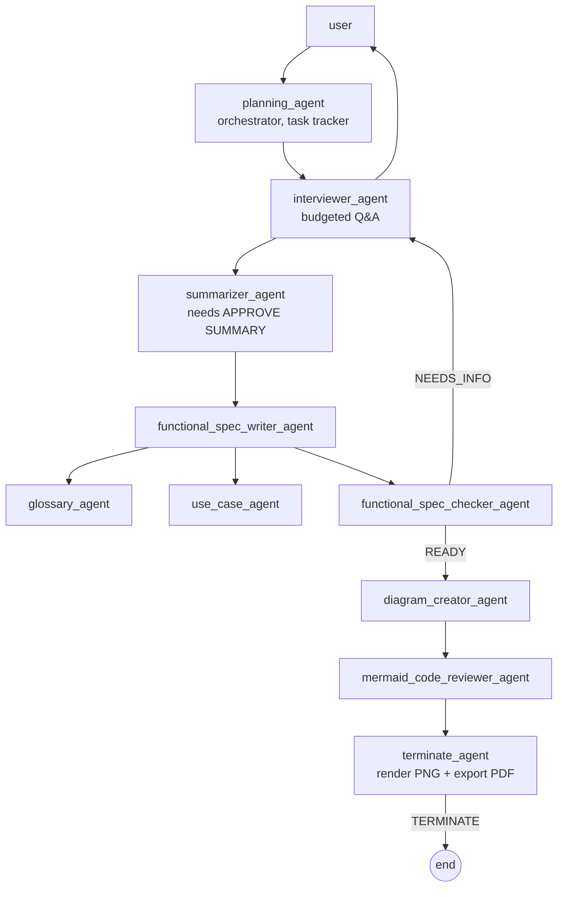

# BA-GPT — Multi-Agent Business Analyst

A local-first AI business analyst that runs a budgeted, deterministic requirements
interview with a human and produces a traceable **Functional Specification
Document (FSD)**, a Mermaid process diagram, and a PDF deliverable.

Built on **AutoGen 0.7** (selector group chat), **Chainlit** (web UI), and two
stdio **MCP servers** for diagram rendering and document export.

> ## ⚠️ Technical preview
>
> This is a **technical preview** release (v1.1.0). The agent team, pipeline
> and deliverable formats are stable enough for evaluation, but the project
> is still under active development and details may change.
>
> In particular, the **Chainlit web UI is a debug/operator view, not a
> finished end-user product**: it exposes internal pipeline state —
> per-category interview progress (`asked=N, status=done`), live agent
> statuses (`done` / `pending` / `not started`), raw `[ASSIGNMENT]` task
> dispatches and tool-call traces. That is exactly what you want while
> developing or auditing the multi-agent workflow, and more noise than a
> final product would show.


---

## What you get

After one session, `conversation/<SESSION_ID>/` contains:

| File | What it is |
|---|---|
| `interview.jsonl` | every Q&A turn, timestamped |
| `functional_specification.md` | 9-section FSD: scope, FRs, NFRs, roles, assumptions, use cases, glossary. Carries the rendered diagram and its Mermaid source |
| `functional_specification.html` | Self-contained HTML: the diagram PNG is inlined as a data URI, so the file opens and prints without the image sitting next to it |
| `process_diagram.mmd` | Mermaid canvas: every diagram the reviewer produced, one fenced block each |
| `process_diagram_N.png` | One rendered PNG per canvas diagram (the first is `process_diagram.png`) |
| `process_diagram.png` | rendered diagram |
| `functional_specification.formatted.md` | FSD with requirements tables and page breaks |
| `functional_specification.pdf` | PDF export with a real bookmark outline (`pandoc` + `xelatex` optional; PyMuPDF fallback when they are absent) |

## Quick start

```bash
# 1. Install
python -m venv .venv
.venv\Scripts\activate              # Windows
# source .venv/bin/activate         # Linux / macOS

pip install -r requirements.txt
npm i -g @mermaid-js/mermaid-cli    # required for the PNG diagram

# 2. Configure
cp .env.example .env                # then set OPENAI_API_KEY

# 3. Verify the machine
python scripts/smoke_check.py

# 4. Run
chainlit run app2.py -w
```

Open http://localhost:8000, type a task ("Design an order fulfilment process"),
and answer the interviewer. The run ends when `terminate_agent` exports the
deliverables.

Detailed setup: [docs/configuration.md](docs/configuration.md)
Design and agent flow: [docs/architecture.md](docs/architecture.md)
Common failures: [docs/troubleshooting.md](docs/troubleshooting.md)

## How the team works



Eleven agents in one `SelectorGroupChat`. Hand-offs are driven by the planner's
`[ASSIGNMENT]` markers and `READY` signals. The run is capped by `MAX_MESSAGES`
(default 300) and ends when `terminate_agent` emits `TERMINATE`.

## Model backends

Three lanes are selectable in `.env`: `MODEL_CLIENT` (reasoning agents),
`MODEL_CLIENT_TOOLS` (tool-calling agents) and `HUMAN_MODEL` (simulated
stakeholder). Any profile below can fill any lane.

| Profile | Backend | Key env var |
|---|---|---|
| `openai` | OpenAI | `OPENAI_API_KEY` |
| `openai_npt` | OpenAI with `parallel_tool_calls: false` | `OPENAI_API_KEY` |
| `azure` | Azure OpenAI | `AZURE_OPENAI_API_KEY` |
| `groq` | Groq (`openai/gpt-oss-120b`) | `GROQ_API_KEY` |
| `hugging` | Hugging Face router | `HF_TOKEN` |
| `github` | GitHub Copilot models | `GITHUB_TOKEN` |
| `opencode` | OpenCode Go (`gpt-6-luna`) | `OPENCODE_GO_API_KEY` |
| `strata` | local Strata / llama.cpp server | none |
| `lmstudio` | local LM Studio | none |
| `ollama` | local Ollama | none |
| `onnx` | local ONNX server | none |

API keys are never stored in the YAML profiles - `src/model_loader.py` injects
them from the environment or `.env`. Set `SIMULATE_HUMAN=true` to run the
stakeholder interview on the `HUMAN_MODEL` lane instead of typing answers.

## Two entry points

- `app2.py` - agents defined inline; the recommended, self-contained app.
- `app.py` - the same team loaded from `lib/agents_config.yaml`.

Both use the same model loader, selector, RAG memory and tools.

## Tests

```bash
python -m pytest -q tests
```

| Test | Covers | Needs |
|---|---|---|
| `tests/test_pipeline.py` | file/JSONL tools, selector routing, config hygiene | nothing |
| `tests/test_mcp_servers.py` | boots both MCP servers, checks their tools | `mmdc` for one test (skipped otherwise) |
| `tests/test_end_to_end.py` | the whole 11-agent team with a scripted model client | `mmdc` (skipped otherwise); **no API key, no network** |

The end-to-end test asserts the interview log, the spec in `conversation/<session>/`
and the rendered PNG all exist.

## Project layout

```
app.py / app2.py          Chainlit entry points
lib/                      agent factory, tools, selector, RAG indexer, MCP boot
src/                      model client loader + model profiles
mcp_servers/              Mermaid renderer + deliverable formatter (stdio MCP)
scripts/smoke_check.py    release-readiness checker
tests/                    offline pytest suite
data/                     reference docs indexed into ChromaDB (local, gitignored)
conversation/            working files during a session (gitignored)
conversation/<session>/  final deliverables (gitignored)
docs/                     architecture, configuration, troubleshooting + thesis material
```

## Requirements

| Requirement | Needed for |
|---|---|
| Python 3.11+ (tested on 3.13) | the app |
| Node.js + `mermaid-cli` | PNG/SVG diagram rendering |
| `pandoc` + `xelatex` | nicer PDF export; **optional** - without them the PDF is built with PyMuPDF Story |
| An LLM (OpenAI / Ollama / LM Studio) | the agents |

## Known limitations

- The interview is interactive: a human must answer every `QUESTION:`.
- `summarizer_agent` only accepts the exact phrase `APPROVE SUMMARY`.
- PDF export uses `pandoc`/`xelatex` when available, otherwise PyMuPDF Story.
- ChromaDB embeddings run locally via `paraphrase-multilingual-mpnet-base-v2` (CPU by default).

## License

MIT - see [LICENSE](LICENSE).

## Citation

This project is part of a Master's thesis (TFM) on multi-agent requirements
elicitation. The design rationale is in [IDEA.md](IDEA.md).
